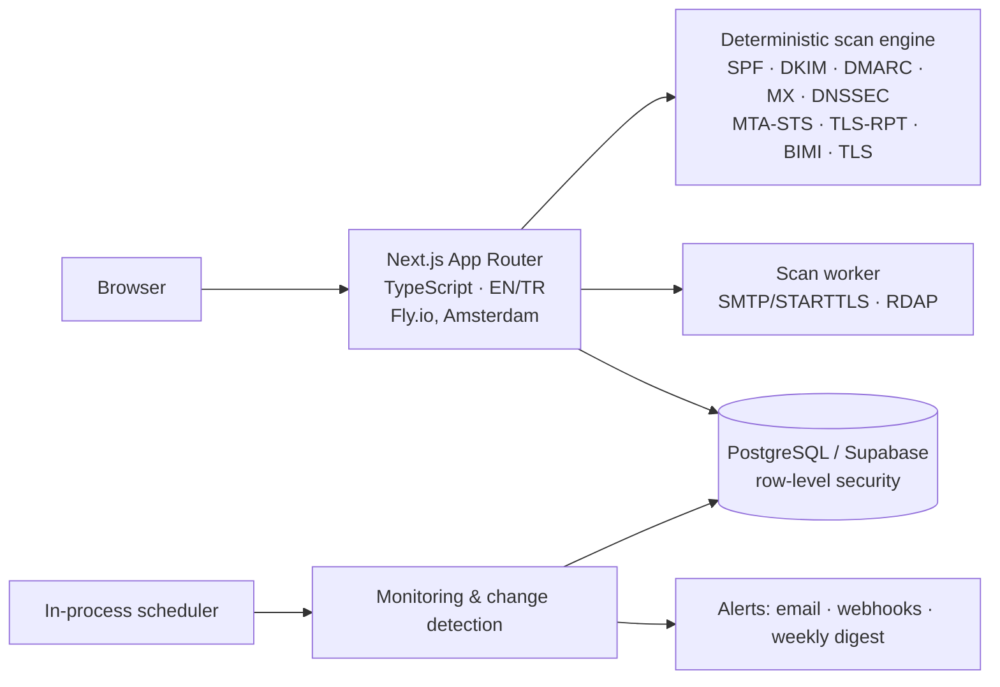

# Umut Becan

**Enterprise infrastructure · migrations and recovery · security and audits · Founder of [Korantix](https://korantix.io)**

I have run enterprise IT for about twenty years, from the support desk and server rooms to private cloud operations, disaster recovery tests, IT audits, mail and file migrations and the IT side of company separations. I turn what works into open tools and playbooks, and I founded Korantix for email and domain security. MSc in Computer Engineering.

### Start here

| | |
|---|---|
| **Run the domain security CLI** | `npx github:UmutBecan/security-operations-toolkit all yourdomain.com` checks SPF, DMARC, MX, TLS and HTTP security headers. Read-only, no install. [Repository →](https://github.com/UmutBecan/security-operations-toolkit) |
| **Read the Microsoft 365 weekend migration case** | How a group of users moved mail, calendars and files to Microsoft 365 in one weekend window: what was agreed first, the schedule, and what I would check earlier. [Case →](https://github.com/UmutBecan/it-leadership-playbooks/blob/main/case-studies/09-weekend-mail-and-file-migration.md) · [Weekend Migration Kit →](https://github.com/UmutBecan/it-leadership-playbooks/tree/main/kits/microsoft-365-weekend-migration) |
| **Scan a domain with Korantix** | Score, the first finding to fix and the exact record to publish, from public data only. [korantix.io →](https://korantix.io/en) |

Planning a Microsoft 365 migration or reviewing a domain's email security? [Message me on LinkedIn](https://www.linkedin.com/in/umutbecan).

---

## What I work on

- **Infrastructure and resilience:** virtualization, private cloud, backup and recovery, network design, planned recovery testing.
- **Migrations and separations:** mail and file moves to Microsoft 365, and the IT side of selling or separating part of a company.
- **Security and governance:** hardening baselines, vulnerability management, audit readiness, security awareness, vendor management.
- **Operations and service management:** service desk, endpoint and mobile device management, patching, service levels, multi-country field support.
- **Budget and delivery:** OPEX and CAPEX models, KPI scorecards, project portfolios.
- **Building:** Korantix, open tools, and an operating model for AI-assisted IT work with approval gates.

---

## Open tools

| Repository | Who it helps | Try it in a minute |
|---|---|---|
| [security-operations-toolkit](https://github.com/UmutBecan/security-operations-toolkit) | IT and DevOps teams that want a scriptable answer to "is anything obviously wrong with this domain?" | Scan a list of domains and get SARIF for GitHub code scanning: `--file domains.txt --format sarif`. Covers SPF, DMARC (RFC 9989), MTA-STS, TLS-RPT, DKIM by selector, TLS and HTTP headers. |
| [it-leadership-playbooks](https://github.com/UmutBecan/it-leadership-playbooks) | IT managers who plan migrations, audits and budgets and do not want to start from a blank page | Open the [Microsoft 365 Weekend Migration Kit](https://github.com/UmutBecan/it-leadership-playbooks/tree/main/kits/microsoft-365-weekend-migration) and compute your batch plan and latest go/no-go time from rehearsal throughput. |
| [enterprise-infrastructure-lab](https://github.com/UmutBecan/enterprise-infrastructure-lab) | Infrastructure engineers who need designs that show how they are tested and operated | Run a [restore drill](https://github.com/UmutBecan/enterprise-infrastructure-lab#run-a-restore-drill) that measures RTO and RPO against targets and writes a sealed evidence record an auditor can verify. |
| [agent-operating-model](https://github.com/UmutBecan/agent-operating-model) | Teams using AI coding agents who need approvals, cost limits and a way to block risky commands | Copy the [Claude Code permissions demo](https://github.com/UmutBecan/agent-operating-model/tree/main/examples/claude-code-permissions): policy as code, tested against 185 bypass attempts. |

---

## Korantix

**Domain and email security monitoring from public data only. No credentials, no tenant access, no installed agent.**

Enter a domain and get a deterministic score, the one finding to fix first, who should fix it and the exact record to publish. Accounts add daily monitoring, change detection and alerts. [Try it with your domain →](https://korantix.io/en?domain=yourcompany.com)

Rule-based scoring: the same DNS answers give the same score; no model guesses a security verdict. DKIM is never reported missing without a known or discovered selector.

---

<!-- START_DYNAMIC_PORTFOLIO -->
### Live status and activity

- [Korantix](https://korantix.io): 🟢 Operational · HTTP 200 on `/api/health`
- Public commits in the last 30 days: **61** · languages by code size: Python 70% · JavaScript 30%

### Current engineering focus (last 7 days)

- `security-operations-toolkit`: chore(release): number the release v1.1.0 (v1.0.0 tag already exists)
- `security-operations-toolkit`: chore(release): v0.2.0 changelog, release notes, Actions example, verified run
- `security-operations-toolkit`: ci: test on Node 20, 22 and 24
- `security-operations-toolkit`: feat(cli): --help exits 0; add next-step hint and --no-hint
- `security-operations-toolkit`: fix(mail): follow RFC 9989 for DMARC pct/t and tree walk; RFC 5321 implicit MX

_Last refreshed: 2026-11-16 22:02 UTC · public data only · [how](scripts/sync-profile.mjs)_
<!-- END_DYNAMIC_PORTFOLIO -->

---

## How I work

- Architecture should be operable, not only designed.
- Security should be measurable and deterministic.
- Evidence comes before claims.
- Automation should remove friction, not add moving parts.
- Everything published here is written fresh and generalized.

## Academic

MSc in Computer Engineering. Coursework on machine learning (KNIME), big data (Hadoop and Hive) and mobile networks is in [academic](https://github.com/UmutBecan/it-leadership-playbooks/tree/main/academic).

## Contact

[LinkedIn](https://www.linkedin.com/in/umutbecan) · [korantix.io](https://korantix.io) · destek@korantix.io
