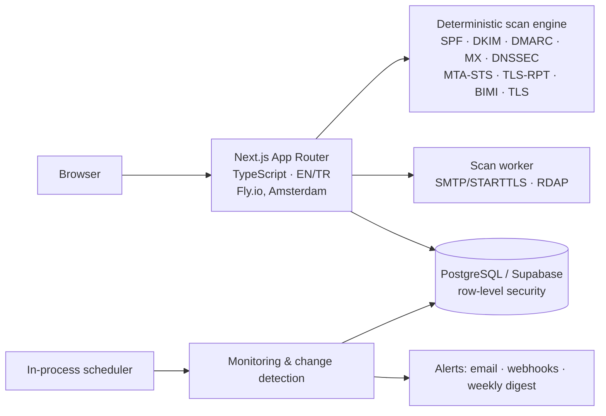

# Umut Becan

**Building deterministic B2B SaaS, email & domain security infrastructure, and AI-driven intelligence systems.**

Founder of [Korantix](https://korantix.io). About twenty years in enterprise IT operations, infrastructure, security and technology governance. I started at the support desk and in server rooms, and I still build, test and run what I design.

---

## Flagship: Korantix

**Domain and email security monitoring from public data only. No credentials, no tenant access, no installed agent.**

Enter a domain and get a deterministic score, the one finding to fix first, who should fix it and the exact record to publish. Accounts add daily monitoring, change detection and alerts.

**Try it:** [korantix.io/en?domain=yourcompany.com](https://korantix.io/en?domain=yourcompany.com) opens the scanner with your domain filled in.

| | |
|---|---|
| **Scoring** | Rule-based and repeatable: the same DNS answers give the same score. No model guesses a security verdict. |
| **Scope** | Public DNS, TLS and SMTP data only. DKIM is never reported missing without a known or discovered selector. |
| **Stack** | Next.js (App Router), TypeScript, PostgreSQL on Supabase with RLS, Fly.io, Resend, Creem billing |
| **Quality gates** | Type check, ~3,000 unit tests, Playwright browser checks, axe accessibility checks |

---

## Featured engineering

| Repository | Problem | Solution |
|---|---|---|
| [security-operations-toolkit](https://github.com/UmutBecan/security-operations-toolkit) | Expired certificates, missing DMARC and weak HTTP headers are usually found late, by a customer or an auditor. | Zero-dependency Node CLI with read-only checks and a remediation hint per finding. Run it now: `npx github:UmutBecan/security-operations-toolkit all example.com` |
| [agent-operating-model](https://github.com/UmutBecan/agent-operating-model) | AI agents drift, overspend and act without approval when nobody defines the rules. | Copy-and-edit operating model: roles, cost modes, decision register, evidence rules, approval gates and a fail-closed Claude Code command hook. |
| [it-leadership-playbooks](https://github.com/UmutBecan/it-leadership-playbooks) | IT teams rebuild the same budget, service desk and audit material in every company. | Vendor-neutral templates: budget model, service desk, audit readiness, disaster recovery, hardening. |
| [enterprise-infrastructure-lab](https://github.com/UmutBecan/enterprise-infrastructure-lab) | Reference architectures rarely show how they are tested and operated. | Layered architecture, quality engineering and agent-engine design, documented like production. |

---

<!-- START_DYNAMIC_PORTFOLIO -->
### Live product status

| Product | Status |
|---|---|
| [Korantix](https://korantix.io) | 🟢 Operational · HTTP 200 on `/api/health` |

### Latest shipped & active builds

| Repository | What it is | Language | Last push |
|---|---|---|---|
| [security-operations-toolkit](https://github.com/UmutBecan/security-operations-toolkit) | Defensive, read-only checks for a domain's external security posture: email authentication (SPF, DMARC), TLS certificates and HTTP security headers, with remediation hints. | JavaScript | 2026-11-16 |
| [agent-operating-model](https://github.com/UmutBecan/agent-operating-model) | Copy-and-edit operating model for working with AI agents: roles, cost modes, decision register, evidence rules, approval gates, and a fail-closed Claude Code command hook. | Python | 2026-11-16 |
| [enterprise-infrastructure-lab](https://github.com/UmutBecan/enterprise-infrastructure-lab) | Reference designs for enterprise infrastructure, from hardware to services: network segmentation, backup and recovery, access model, quality gates and an AI-agent operating model. Short, reviewable, sanitized. | Python | 2026-10-28 |
| [it-leadership-playbooks](https://github.com/UmutBecan/it-leadership-playbooks) | Ready-to-adapt IT operations playbooks: budget model, service desk, patching, vulnerability management, audit readiness, KPIs and vendor management. Vendor-neutral, written to be copied and edited. | Python | 2026-10-28 |

### Engineering activity (public repositories)

- Commits in the last 30 days: **52**
- Languages by code size: Python 70% · JavaScript 30%

### Current engineering focus (last 7 days)

- `security-operations-toolkit` — docs: npx one-liner, real JSON example, package metadata
- `security-operations-toolkit` — docs: add quick start and Korantix bridge
- `agent-operating-model` — chore: ignore secret material
- `agent-operating-model` — ci: remove outdated draft comment from tests workflow
- `security-operations-toolkit` — docs: use full name in license copyright line

_Last refreshed: 2026-11-16 21:13 UTC · public data only · [how](scripts/sync-profile.mjs)_
<!-- END_DYNAMIC_PORTFOLIO -->

---

## How I work

- Architecture should be operable, not only designed.
- Security should be measurable and deterministic.
- Evidence comes before claims.
- Automation should remove friction, not add moving parts.
- Everything published here is written fresh and generalized.

## Academic

MSc in Computer Engineering. Coursework on machine learning (KNIME), big data (Hadoop and Hive) and mobile networks is in [academic](https://github.com/UmutBecan/it-leadership-playbooks/tree/main/academic).

## Contact

[LinkedIn](https://www.linkedin.com/in/umutbecan) · [korantix.io](https://korantix.io) · destek@korantix.io
